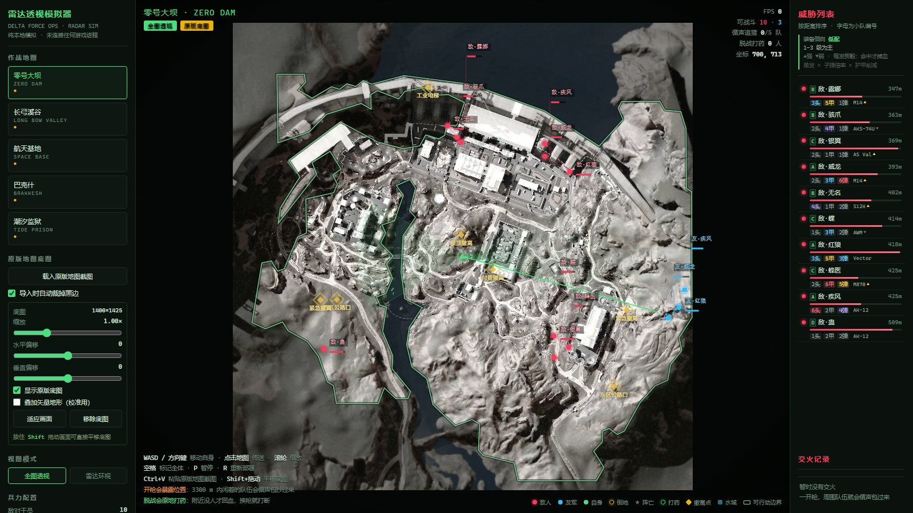

# 三角洲行动 · 雷达透视模拟器

一个**纯本地、单文件、零依赖**的《三角洲行动》雷达透视风格模拟器。打开网页就能看到五张官方地图上 15 名"干员"分小队行动、交火、倒地、救援、阵亡的完整推演过程。

> 纯前端娱乐 / 学习项目，与腾讯天美及《三角洲行动》官方无关，不含任何游戏内作弊功能。

## 在线试玩

👉 **https://hh-567.github.io/delta-radar-simulator/**

也可以下载 `三角洲雷达模拟器.html` 后双击，浏览器直接打开即可，无需服务器、无需联网（地图已内嵌）。

## 功能特性

### 地图
- 五张图全部使用**官方原版底图**：零号大坝、长弓溪谷、航天基地、巴克什、潮汐监狱
- 底图由在线瓦片拼接后处理内嵌，断网也能正常显示
- 支持自备截图：点「载入原版地图截图」可导入自己的图，`Shift + 拖拽` 微调对齐，自动存在浏览器本地

### 空气墙 / 可行动区域
- 不是简单画方框，而是从地形种子做**测地膨胀生长**，再经开闭运算、两次 Chaikin 平滑、`approxPolyDP` 简化，得到贴合真实地形的 84~129 点边界
- 建筑按**真实屋顶轮廓**作为障碍，水面真实不可站立
- 边界内可走率 89~96%，42px 栅格最大连通域覆盖 90~100%，随机 60 对点寻路 **60/60** 全通

### 干员与装备
- 15 名干员：红狼、威龙、疾风、无名、骇爪、露娜、银翼、蜂医、蝶、蛊、液氮、牧羊人、深蓝、乌鲁鲁、比特
- 每人带 1~6 级头盔 / 护甲 / 子弹 + 枪械
- **装备稀有度按地图区分**：例如航天基地 5 级弹最常见，4/5/6 级甲数量接近且明显多于 1~3 级

### 战斗系统
- **三人小队**编组，A* / BFS 沿可走区域行进，不会穿墙、不会贴着水走
- 状态机：`交火 > 救援 > 循声 > 打药 > 推进`
- **概率命中 + 单发伤害**：命中率与伤害由枪械、子弹等级、护甲等级共同决定，不按 DPS 粗暴结算
- 倒地 → 队友花时间救起 → 再次被打倒且血条清空则**第一次死亡**（尸体仍可救）→ 第二次死亡**永久阵亡**，不再补人
- 队伍全灭 / 全员倒地时，倒地成员直接死亡
- **不攻击遗体**：目标筛选只认「存活 / 倒地」，不会对着尸体清空弹匣

### 声音传导与混战
- 任何一人开枪，**3300 米内所有队伍**都会收到枪声线索（当前地图尺度下等于全图可闻）
- 空闲队伍（非交火 / 非救人 / 非打药）会循声包抄：0.6~2.6s 反应延迟 → 前往声源 → 到点搜索 → 17s 线索过期 → 10s 冷却，不会无限追一条假线索
- 不同队伍之间自由交战，多方混战会自然形成
- 队级枪声节流 + 帧令牌，避免一帧内多队重复开火导致清场过快

### 打药回血
- 脱战后**原地站着不动**打药：3.6 秒读条回 58 血，冷却 6.5 秒
- 读条期间自己挨枪立刻打断，并放弃本次治疗
- 需要队友收拢到 150px 内才开始（避免边跑边打药）
- 屏幕上有绿色进度环显示读条

## 操作说明

| 操作 | 作用 |
| --- | --- |
| `W` `A` `S` `D` / 方向键 | 移动雷达中心（自己） |
| 鼠标滚轮 | 缩放 0.5× ~ 3× |
| `空格` | 标记全体干员 |
| `P` | 暂停 / 继续 |
| `R` | 重新部署本图 |
| `Shift + 拖拽` | 微调导入底图的对齐位置 |

界面按钮：载入原版地图截图、适应画面、移除底图、全图透视、雷达环视、暂停、标记全体、重新部署。

## 技术说明

- 单文件 HTML + Canvas 2D，无框架、无构建、无外部请求
- 官方底图处理链：Leaflet 瓦片（`z=4`，256 块）→ 4096² 拼接 → 提亮 → 裁边 → 1400 宽 JPEG 内嵌 base64
- 地图语义数据（可行动边界、建筑轮廓、撤离点、POI、出生点）由离线脚本从底图图像分析生成后写入 HTML
- 主循环 `requestAnimationFrame`，模拟逻辑与渲染解耦
- 自带回归测试（jsdom + Canvas 桩）：基础行为 60 项、战斗 34 项、循声 28 项、打药 35 项、伤害 24 项、可走区 73 项，共 **254 项**全通过

## 兼容性

Chrome / Edge / Firefox 桌面版。移动端可打开但操作体验不佳（需要键盘）。
底图内嵌约 1.3MB，HTML 整文件约 1.9MB，首次加载可能需要一两秒。

## 免责声明

本项目为个人娱乐与前端技术练习，与腾讯、天美工作室群及《三角洲行动》官方**没有任何关系**，不含内存读写、注入、反作弊绕过等任何实际游戏作弊手段，仅在一个独立网页里做纯视觉模拟。
地图影像版权归原权利方所有，本项目仅作学习演示用途，如有侵权请联系删除。
